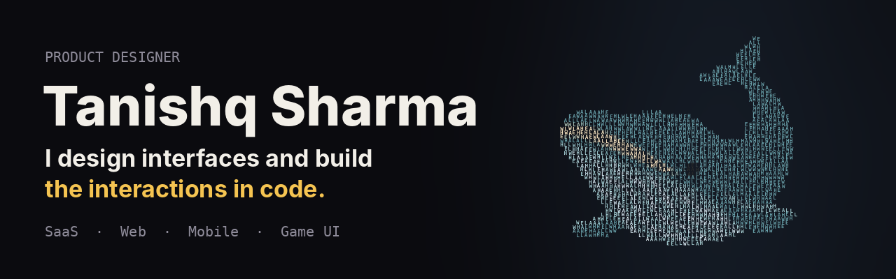

I'm a product designer working across SaaS, web, mobile and game UI. I design in Figma and prototype the interactions in code, so what ships feels the way it was designed.

- Product Designer at **Eclipsera Legends**
- Freelance designer at **Starwinklabs**
- Portfolio and case studies: **[tanishq-designs.vercel.app](https://tanishq-designs.vercel.app/)**

## Featured

### [Tactile Playground](https://github.com/Tanishq890/tactile-playground) · [live site](https://tactile-playground-nu.vercel.app)

Interface elements that behave like real materials. Each one is a single HTML file, MIT licensed and free to reuse.

| Experiment | What it is |
|---|---|
| [Tactile Button Lab](https://tactile-playground-nu.vercel.app/lab) | 60 elements, from liquid-metal tabs and a rotary OTP to a shredder delete and a fingerprint confirm |
| [Wordforms](https://tactile-playground-nu.vercel.app/wordforms) | Type a word and its own letters swarm into the shape of the thing it names |
| [Haunted UI Kit](https://tactile-playground-nu.vercel.app/haunted) | Eight possessed components: a ghost cursor, a Ouija answer box, a midnight button |
| [Survive the Wait](https://tactile-playground-nu.vercel.app/survive-the-wait) | A one-minute arcade game about waiting for GTA 6 (fan parody) |
| [IPO Allotment Machine](https://tactile-playground-nu.vercel.app/allotment-machine) | A slot machine that tells you what you already knew |

## Get in touch

[Portfolio](https://tanishq-designs.vercel.app/) · [LinkedIn](https://www.linkedin.com/in/ertanishqsharma/)

Open to freelance and contract design work, remote or on-site.
